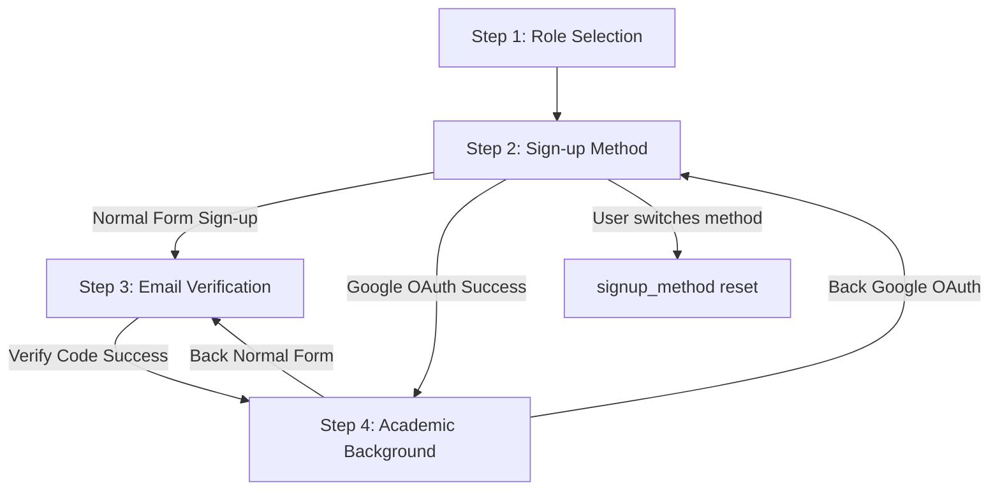

# Onboarding Wizard - Sign-up State Navigation Logic

## 1. Flow Routing Overview

## 2. State Variable Schema

* `signup_method` (string | null): `'form'` | `'google'` | `null`
  - Set to `'google'` ONLY after Google OAuth returns a verified success response — never on button click alone.
  - Set to `'form'` ONLY after the manual form is submitted successfully and moves the user to Step 3.
  - Reset to `null` whenever the user returns to Step 2 and has not yet completed either path again.
* `account_created` (boolean): true only once a real account record exists server-side. Step 4 must never be reachable with this false.
* `email_verified` (boolean): true once code verification succeeds, or true immediately for Google accounts.

## 3. Navigational Logic Rules

### Rule A — Normal Form Flow
1. Step 2 form submit → account created, `signup_method = 'form'`, `account_created = true` → Step 3.
2. Step 3 code success → `email_verified = true` → Step 4.
3. Step 4 Back → Step 3 (only if `signup_method === 'form'`).

### Rule B — Google OAuth Flow
1. Step 2 "Sign up with Google" clicked → OAuth popup opens.
   - On success: account created, `signup_method = 'google'`, `account_created = true`, `email_verified = true` → Step 4 directly.
   - On failure/cancel: remain on Step 2, `signup_method` stays `null`, show inline error. No state transition occurs.
2. Step 4 Back → Step 2 (only if `signup_method === 'google'`).

### Rule C — Method Switching Guard (the missing piece)
1. Any time the user is back on Step 2 after having reached Step 3 or Step 4, `signup_method` and `account_created` reset to their pre-signup defaults (`null` / `false`) UNLESS they are returning via the exact Back path that matches their original method (i.e., they haven't tried the other method in between).
2. If the user then chooses the *other* method on Step 2 (e.g. switches from Google to manual form, or vice versa), the wizard must treat this as a fresh signup attempt: clear any previous `account_created` flag from the abandoned method before creating the new one, so an abandoned Google account and a completed form account can never both exist half-finished under the same session.

### Rule D — Direct/Refreshed Access Guard
1. Step 3 and Step 4 must verify `account_created === true` (and, for Step 4, `email_verified === true`) server-side before rendering. If either check fails, redirect to Step 2 rather than trusting client-side step state alone.