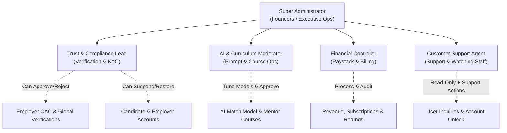

# 46 - Admin Dashboard Architecture, UI/UX Design System & Verification Governance

**Document Reference:** `docs/46-admin-dashboard-architecture-and-design-specification.md`  
**Target Audience:** Product Designers, UI/UX Engineers, Frontend & Backend Developers, Super Admins  
**Status:** Canonical Master Specification  
**Last Updated:** November 2026  

---

## 1. Executive Overview & Mission Control Context

InternConnect connects tens of thousands of Nigerian university students, NYSC corps members, fresh graduates, and global interns with verified corporate employers through AI-driven matching, ATS resume evaluation, and direct interview pipelines.

While the Candidate and Employer portals are production-ready, the **Admin Portal** serves as the central operational mission control for:
1. **Platform Integrity & Global Verification**: Verifying Corporate Affairs Commission (CAC) registration in Nigeria as well as international outsource/company registries, ensuring legitimate employers while preventing job scams.
2. **Student Placement & Moderation**: Overseeing candidate pipelines, profile completeness, university representations, and student safety.
3. **Jenny AI Governance**: Monitoring nightly scoring algorithms, flagged match anomalies, Gemini token consumption, and model parameters.
4. **Operations & Customer Care Hierarchy**: Equipping hired platform moderators ("Customer Care Specialists" / "Watching Staff") to resolve issues, unlock accounts, and assist users without accessing sensitive Super Admin financial settings or system credentials.

---

## 2. Global Company Verification Desk & Badge Visibility Contract

### 2.1 Dual-Path Verification Workflow
Employers on InternConnect can operate locally within Nigeria or internationally across Africa and global markets. Verification is handled via two pathways:
1. **Automated Registry API Lookup**:
   - For Nigerian entities: Direct query to CAC corporate database via business registration number (RC / BN number).
   - For International / Outsource entities: Automated lookup via international company registries (e.g. Companies House, Delaware registry, OpenCorporates API).
2. **Document / Certificate Review (Manual Desk)**:
   - When API automated lookup is inconclusive, employers upload their CAC Certificate of Incorporation, Tax Identification Number (TIN), or official certificate of incorporation.
   - Verification Officers review the document preview in the Admin Verification Desk and approve or reject with reason notes.

### 2.2 Strict Badge Visibility Rule (Zero Negative Label Policy)
- **Verified State**: When a company is verified (via API match or manual document approval), display the standardized clean verified badge:
  - SVG checkmark inside soft green pill: `Verified Employer`.
- **Unverified / In-Review State**: **DO NOT display "Unverified", "Pending", or any negative/warning badge on public listings, job cards, or candidate views.**
  - **Rule**: If an employer is NOT verified, the badge is **completely absent / invisible**. The user sees only the company name, logo, location, and description without any badge.
  - This ensures unverified but genuine newly registered employers are not publicly penalized or stigmatized while undergoing verification, while fully protecting students.

---

## 3. Role-Based Access Control (RBAC) & Administrative Staff Hierarchy

To support operational scaling and allow the organization to hire customer support agents ("watching staff") without risking core business data or system keys, the Admin system enforces a 5-tier role hierarchy:



### 3.1 Staff Role Matrix

| Staff Role | Standard Title | Accessible Modules | Key Operational Permissions | Restricted Access |
|:---|:---|:---|:---|:---|
| **Super Admin** | `Platform Admin` / `System Owner` | All Modules (Overview, Interns, Employers, AI, E-Learning, Finance, Team Settings) | Full read/write, staff invitations, role assignments, system-wide configuration, database maintenance. | None |
| **Trust & Compliance Lead** | `Verification Officer` | Overview, Interns, Employers, E-Learning | Approve/reject CAC registrations, audit student university credentials, suspend fraudulent accounts. | Cannot view Paystack revenues or modify staff roles. |
| **Customer Support Agent** | `Customer Success Specialist` ("Watching Staff") | Overview (Read-Only), Interns, Employers | Search candidates and employers, inspect profiles, view application statuses, assist with password/2FA resets. | Cannot approve CAC documents, cannot issue refunds, cannot view API keys. |
| **AI & Curriculum Moderator** | `AI Operations Specialist` | Overview, AI Integration, E-Learning | Review flagged AI matches, monitor Gemini token costs, approve mentor course submissions. | Cannot view user personal contact information or financial ledgers. |
| **Financial Controller** | `Finance & Billing Specialist` | Overview, Employers (Billing view), Subscriptions | Audit Paystack transactions, view MRR metrics, approve verified refund requests. | Cannot edit job posts, cannot alter AI prompt configs. |

---

## 4. Admin Navigation & Sidebar Submenu Architecture

The Admin Sidebar features a 240px clean structure with collapsible submenus:

```
[ InternConnect Logo ]

MANAGE (Section Label)
├── 📊 Overview
├── 👥 Interns (Collapsible Submenu)
│   ├── All Interns
│   ├── Active Candidates
│   ├── Placed Interns
│   └── Awaiting Review (Badge: 37)
├── 🏢 Employers (Collapsible Submenu)
│   ├── All Employers
│   ├── Verification Queue (Badge: 14)
│   ├── Verified Employers
│   └── Flagged Accounts
├── 🔮 AI Integration (Badge: 6) (Collapsible Submenu)
│   ├── Model Health & Performance
│   ├── Flagged AI Matches (6)
│   ├── Gemini Token & Cost Monitor
│   └── Prompt & Weight Tuning
├── 🎓 E-Learning (Badge: 3) (Collapsible Submenu)
│   ├── Course Submissions (3)
│   └── Published Catalog
├── 💳 Subscriptions & Finance (Collapsible Submenu)
│   ├── Overview & MRR
│   ├── Paystack Transactions
│   └── Refund Requests (2)
└── ⚙️ Settings & Team (Super Admin)
    ├── Staff & Roles ("Watching Staff")
    ├── Platform Configuration
    └── Audit Logs

[ Bottom Staff Profile Card: Jayden Okafor · Platform Admin · [Logout Icon] ]
```

---

## 5. Screen Specifications & Blueprint

### 5.1 Overview / Command Center (`/admin` or `/admin/overview`)
- **Top Control Bar**: Omnisearch input (`Search interns, employers, courses...`), notification bell with red active indicator dot, and solid indigo CTA button `Export report`.
- **4 Key Metric Cards**:
  1. `Interns Registered`: **12,480** (`+312 this week`, soft green trend pill).
  2. `Employers`: **486** (`+19 this month`, soft green trend pill).
  3. `AI Match Acceptance`: **71%** (`+3 pts vs September`, soft green trend pill).
  4. `Active Learners`: **4,920** (`+8% this month`, soft green trend pill).
- **Primary Charts & Triage Grid (2 Columns, 2fr : 1.2fr)**:
  - **Applications & Placements Bar Chart**: Dual-series visualization tracking submitted applications vs. confirmed hires.
  - **"Needs Your Attention" Action Queue**:
    - `14 employers awaiting verification` &rarr; routes to verification desk.
    - `6 AI matches flagged for review` &rarr; routes to AI console.
    - `3 courses awaiting review` &rarr; routes to e-learning moderation.
    - `2,620 incomplete intern profiles` &rarr; nudge campaign trigger.
- **Bottom Analytical Row (2 Columns, 1.6fr : 1.4fr)**:
  - **From Sign-Up to Placement Funnel**:
    - Progress bars: `Registered (100%)` &rarr; `Profile Complete (79%)` &rarr; `Applied (57.8%)` &rarr; `Interviewed (23.6%)` &rarr; `Placed (10.5%)`.
  - **Recent Activity Audit Feed**:
    - Real-time event log with staff initials avatars, timestamps, and target records.

### 5.2 Interns Directory & 420px Profile Inspector Drawer (`/admin/interns`)
- **Top Metric Cards**: `12,480 Total Interns`, `8,134 Active This Month`, `1,312 Placed`, `37 Awaiting Review`.
- **Filter Tabs**: `All (12,480)` | `Active` | `Placed` | `Awaiting Review (37)` | `Suspended`.
- **Master Table**: Columns for `Intern` (avatar, name, email), `University`, `Apps`, `AI Match` score pill, `Profile` completeness bar, `Status` pill.
- **Profile Inspector Slide-Over Drawer (420px Width)**:
  - Slides out smoothly when clicking any row.
  - Candidate header with initials, name, university, and close button.
  - Candidate skill tag pills (`Figma`, `User research`, `Prototyping`, `Wireframing`).
  - Stat counters: `18 Applications`, `5 Interviews`, `2 Offers`.
  - **Jenny AI Insight Box**: Soft purple container with algorithmic match reasoning and course recommendations.
  - **Recent Applications Timeline**: Color-coded application milestones.
  - Sticky Actions: `Open Profile ->` and `Suspend account`.

### 5.3 Employers & Verification Desk (`/admin/employers`)
- **Top Metric Cards**: `486 Total Employers`, `1,038 Open Roles`, `1,312 Placed`, `14 Pending Verification` (consistent across Overview and sidebar).
- **Verification Queue Action Shelf**:
  - Cards displaying oldest pending verification requests side-by-side.
  - Verification checklist pills: `CAC certificate`, `Work email`, `Website live`, plus **Registry Match chip** (`Verified (Active RC)`, `Rechecking API`, `Not found yet`).
  - Actions: `Review` (modal) and `Approve ->` (animates slide-out, displays bottom toast with `Undo`).
- **Employer Directory Table**: Company, Industry, Roles, Applicants, Hires, Verification Status.

---

## 6. Implementation Standards & Zero-Regression Guardrails
1. **NO Colored Accent Border Strips**: Never render colored borders (e.g. `border-left: 3px solid #2563EB`). Use clean neutral borders (`border: 1px solid #E2E8F0;`).
2. **NO Native Boxy HTML Selects**: Use custom Alpine dropdowns (`.db-dropdown-wrap`).
3. **Single-Line Button Integrity**: All buttons enforce `white-space: nowrap !important; flex-shrink: 0 !important;`.
4. **Zero Emojis**: All icons are bounded inline SVGs.
5. **Mobile Responsiveness**: Zero horizontal overflow on mobile viewports.

---

## 7. Complete Admin Page Tree Structure & Authentication Hierarchy

```
InternConnect Admin Mission Control
├── 🔐 Authentication & Security (Isolated Session)
│   ├── /admin/login                 # Email + Password (min 12 chars)
│   ├── /admin/2fa                   # TOTP Authenticator / Email OTP code
│   ├── /admin/forgot-password       # Admin password recovery trigger
│   └── /admin/reset-password        # Cryptographically signed reset token
│
├── 📊 Mission Control Core
│   ├── /admin/overview              # KPI cards, dual-series chart, Jenny insights, action triage, funnel
│   ├── /admin/interns               # Candidate directory, 420px inspector drawer, bulk action bar, suspend modal
│   └── /admin/employers             # Employer directory, CAC verification queue, document review modal
│
├── 🔮 Jenny AI Console (Badge: 6)
│   ├── /admin/ai                    # Model health, nightly throughput (1,904 matches), acceptance rate (71%)
│   ├── /admin/ai/flagged            # Flagged match audit queue (<65% fit score)
│   ├── /admin/ai/tokens             # Gemini API token usage & cost tracking
│   └── /admin/ai/tuning             # Model temperature (0.2), prompt template governance
│
├── 🎓 E-Learning Moderation (Badge: 3)
│   ├── /admin/elearning             # Published course catalog, student completion analytics
│   └── /admin/elearning/submissions # Mentor-submitted curriculum review & approval queue
│
├── 💳 Subscriptions & Finance
│   ├── /admin/subscriptions         # MRR analytics (₦3.84M), plan breakdowns (Free ₦0, Pro ₦2,499, Premium ₦4,999)
│   ├── /admin/subscriptions/ledger  # Paystack transaction audit table & receipts
│   └── /admin/subscriptions/refunds # Refund request approval & reversal desk
│
└── ⚙️ Operations & Staff ("Watching Staff")
    ├── /admin/settings/team         # Staff list, role assignments, invitation modal
    ├── /admin/settings/roles        # Granular RBAC permissions matrix
    └── /admin/settings/audit        # Security audit log (IP, staff ID, action, timestamp)
```

---

## 8. Jenny AI Strategic Insights & Cost Governance

To control API consumption costs while delivering high-impact executive intelligence:
1. **Nightly Batch Processing**:
   - Jenny AI generates strategic operational insights **once daily at 06:00 WAT** via a scheduled cron worker (`php backend/Console/AiDailyInsightsWorker.php`).
   - Results are serialized and cached in Redis / SQLite cache (`cache/ai_daily_insights.json`).
   - The Admin Overview view reads from cache with **zero runtime Gemini API latency or cost**.
2. **Current Production Insights Generated**:
   - **Insight 1 (Profile Quality)**: 2,620 incomplete intern profiles in Lagos & Abuja are lowering match ranking by 44%. Automated reminder campaign ready.
   - **Insight 2 (Employer Role Tuning)**: 14 newly approved employers have 0 applicants after 7 days; automated title & keyword suggestions ready.
   - **Insight 3 (Interview Schedule Optimization)**: Friday 2:00 PM – 5:00 PM shows an 88% show-up rate vs 62% on Monday morning lectures.

---

## 9. Admin REST API Specification (OpenAPI 3.0 / Swagger Compatible)

All administrative endpoints are gated by `AdminAuthMiddleware` checking valid admin session or Bearer JWT with `role: admin`.

### 9.1 Overview & Metrics
* **Endpoint**: `GET /api/v1/admin/overview`
* **Response (200 OK)**:
```json
{
  "status": "success",
  "data": {
    "metrics": {
      "total_interns": { "value": "12,480", "delta": "+2.6% vs last month" },
      "active_employers": { "value": "486", "delta": "+4.1% vs last month" },
      "ai_match_rate": { "value": "71%", "delta": "+3.2% vs last month" },
      "active_learners": { "value": "4,920", "delta": "+8.0% vs last month" }
    },
    "attention_queue_count": 4,
    "pending_verification_count": 14,
    "awaiting_review_count": 37
  }
}
```

### 9.2 Candidate Suspension Action
* **Endpoint**: `POST /api/v1/admin/interns/{id}/suspend`
* **Request Body**:
```json
{
  "reason": "terms|fraud|academic|admin",
  "notes": "Detailed staff audit rationale"
}
```
* **Response (200 OK)**:
```json
{
  "status": "success",
  "message": "Candidate account suspended successfully.",
  "data": { "intern_id": 1, "status": "Suspended", "audit_logged": true }
}
```

### 9.3 Employer Verification Approval
* **Endpoint**: `POST /api/v1/admin/employers/{id}/verify`
* **Response (200 OK)**:
```json
{
  "status": "success",
  "message": "Employer approved. Verified badge is now active on public listings.",
  "data": { "employer_id": 101, "is_verified": true, "verified_at": "2026-11-07T21:00:00Z" }
}
```

---

## 10. Testing Architecture & Execution Guide

The admin module is fully backed by unit and feature test suites:
- **Test Runner**: `php tests/run_tests.php`
- **PHPUnit Config**: `phpunit.xml`
- **Covered Assertions**:
  1. `testAdminMetricsConsistency`: Validates numbers alignment (14 pending verifications, 37 awaiting reviews).
  2. `testUrlHelperGeneratesCorrectAdminPaths`: Validates all admin routing helpers.
  3. `testVerificationBadgeVisibilityRule`: Enforces strict rule that unverified employers do not display negative/unverified badges.


