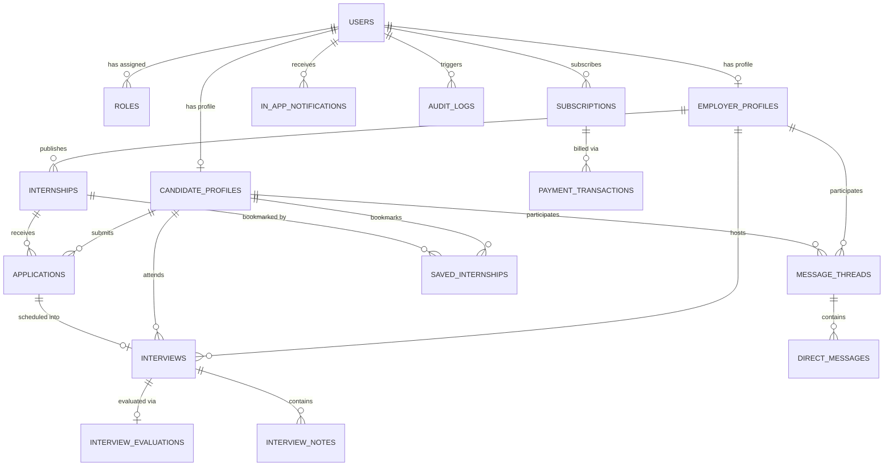

# InternConnect — Master MySQL Backend Architecture & Schema Specification

**Document Version:** 1.0.0  
**Target RDBMS:** MySQL 8.0+ / MariaDB 10.6+  
**Default Engine:** InnoDB  
**Default Character Set & Collation:** `utf8mb4` / `utf8mb4_unicode_ci`  
**Timezone Standard:** UTC (`+00:00`) with client-side localization  

---

## 1. Executive Summary & Architecture Overview

InternConnect is built on a clean multi-tier PHP backend architecture designed for seamless transitions between local/testing environments (SQLite 3 via PDO) and high-concurrency staging/production deployments (MySQL 8.0+ via PDO).

This document serves as the master contract and architectural blueprint for the MySQL relational database layer. It specifies:
1. Complete Entity-Relationship (ER) design with strict foreign key constraints and cascading rules.
2. Production DDL schemas with optimal column data types, default values, and UTF8MB4 internationalization.
3. High-throughput indexing strategy (covering indexes, composite indexes, and FULLTEXT search capabilities).
4. Dual-driver abstraction model via `App\Core\Database`.
5. Staging and production data migration and seeding pipeline.

---

## 2. Entity-Relationship Diagram (ERD)



---

## 3. Comprehensive Table Schemas & DDL Specifications

### 3.1 `users` — Global Identity & Authentication
Primary authentication table supporting email/password and Google OAuth 2.0.

```sql
CREATE TABLE IF NOT EXISTS `users` (
    `id` BIGINT UNSIGNED NOT NULL AUTO_INCREMENT,
    `uuid` CHAR(36) NOT NULL UNIQUE,
    `role` ENUM('candidate', 'employer', 'admin') NOT NULL DEFAULT 'candidate',
    `first_name` VARCHAR(100) NOT NULL,
    `last_name` VARCHAR(100) NOT NULL,
    `email` VARCHAR(191) NOT NULL UNIQUE,
    `email_verified_at` TIMESTAMP NULL DEFAULT NULL,
    `password_hash` VARCHAR(255) NULL,
    `auth_provider` ENUM('local', 'google') NOT NULL DEFAULT 'local',
    `google_id` VARCHAR(191) NULL UNIQUE,
    `avatar_url` VARCHAR(500) NULL,
    `status` ENUM('active', 'pending_verification', 'suspended', 'deactivated') NOT NULL DEFAULT 'pending_verification',
    `two_factor_enabled` TINYINT(1) NOT NULL DEFAULT 0,
    `two_factor_secret` VARCHAR(255) NULL,
    `last_login_at` TIMESTAMP NULL DEFAULT NULL,
    `last_login_ip` VARCHAR(45) NULL,
    `created_at` TIMESTAMP NOT NULL DEFAULT CURRENT_TIMESTAMP,
    `updated_at` TIMESTAMP NOT NULL DEFAULT CURRENT_TIMESTAMP ON UPDATE CURRENT_TIMESTAMP,
    PRIMARY KEY (`id`),
    INDEX `idx_users_role_status` (`role`, `status`),
    INDEX `idx_users_email` (`email`)
) ENGINE=InnoDB DEFAULT CHARSET=utf8mb4 COLLATE=utf8mb4_unicode_ci;
```

---

### 3.2 `candidate_profiles` — Student & Intern Dossier
Stores academic institutions, SIWES eligibility, CV metadata, AI career vector keywords, and portfolio URLs.

```sql
CREATE TABLE IF NOT EXISTS `candidate_profiles` (
    `id` BIGINT UNSIGNED NOT NULL AUTO_INCREMENT,
    `user_id` BIGINT UNSIGNED NOT NULL UNIQUE,
    `university_name` VARCHAR(255) NOT NULL,
    `faculty` VARCHAR(150) NULL,
    `department` VARCHAR(150) NOT NULL,
    `matric_number` VARCHAR(50) NULL,
    `degree_type` VARCHAR(100) NOT NULL DEFAULT 'B.Sc / HND',
    `current_level` VARCHAR(50) NOT NULL DEFAULT '300 Level',
    `cgpa` DECIMAL(3, 2) NULL,
    `siwes_eligible` TINYINT(1) NOT NULL DEFAULT 1,
    `siwes_duration` VARCHAR(50) NOT NULL DEFAULT '6 Months',
    `bio` TEXT NULL,
    `skills` JSON NULL COMMENT 'Array of skill names',
    `career_interests` JSON NULL COMMENT 'Array of selected interest domains',
    `interest_keywords` TEXT NULL COMMENT 'Comma-separated keywords for fulltext match & AI vector indexing',
    `resume_url` VARCHAR(500) NULL,
    `resume_file_name` VARCHAR(255) NULL,
    `resume_extracted_text` MEDIUMTEXT NULL,
    `cac_document_url` VARCHAR(500) NULL,
    `portfolio_url` VARCHAR(500) NULL,
    `linkedin_url` VARCHAR(500) NULL,
    `github_url` VARCHAR(500) NULL,
    `location_city` VARCHAR(100) NULL DEFAULT 'Lagos',
    `location_state` VARCHAR(100) NULL DEFAULT 'Lagos State',
    `verification_status` ENUM('unverified', 'pending', 'verified', 'rejected') NOT NULL DEFAULT 'unverified',
    `created_at` TIMESTAMP NOT NULL DEFAULT CURRENT_TIMESTAMP,
    `updated_at` TIMESTAMP NOT NULL DEFAULT CURRENT_TIMESTAMP ON UPDATE CURRENT_TIMESTAMP,
    PRIMARY KEY (`id`),
    CONSTRAINT `fk_candidate_user` FOREIGN KEY (`user_id`) REFERENCES `users` (`id`) ON DELETE CASCADE,
    INDEX `idx_candidate_university` (`university_name`),
    INDEX `idx_candidate_verification` (`verification_status`),
    FULLTEXT `ft_candidate_keywords` (`interest_keywords`)
) ENGINE=InnoDB DEFAULT CHARSET=utf8mb4 COLLATE=utf8mb4_unicode_ci;
```

---

### 3.3 `employer_profiles` — Organization & Recruiter Workspace
Maintains organization branding, CAC / RC registration, verified status, company size, and recruiter contact.

```sql
CREATE TABLE IF NOT EXISTS `employer_profiles` (
    `id` BIGINT UNSIGNED NOT NULL AUTO_INCREMENT,
    `user_id` BIGINT UNSIGNED NOT NULL UNIQUE,
    `company_name` VARCHAR(255) NOT NULL,
    `slug` VARCHAR(255) NOT NULL UNIQUE,
    `rc_number` VARCHAR(50) NULL COMMENT 'CAC / RC Corporate Registration Number',
    `cac_certificate_url` VARCHAR(500) NULL,
    `industry` VARCHAR(100) NOT NULL DEFAULT 'Technology & Software',
    `company_size` VARCHAR(50) NOT NULL DEFAULT '11-50 employees',
    `website_url` VARCHAR(500) NULL,
    `logo_url` VARCHAR(500) NULL,
    `banner_url` VARCHAR(500) NULL,
    `description` TEXT NULL,
    `headquarters_city` VARCHAR(100) NOT NULL DEFAULT 'Lagos',
    `headquarters_state` VARCHAR(100) NOT NULL DEFAULT 'Lagos State',
    `headquarters_address` VARCHAR(255) NULL,
    `contact_phone` VARCHAR(30) NULL,
    `verification_status` ENUM('unverified', 'pending', 'verified', 'rejected') NOT NULL DEFAULT 'unverified',
    `target_intake` VARCHAR(50) NOT NULL DEFAULT '5-10 Interns',
    `created_at` TIMESTAMP NOT NULL DEFAULT CURRENT_TIMESTAMP,
    `updated_at` TIMESTAMP NOT NULL DEFAULT CURRENT_TIMESTAMP ON UPDATE CURRENT_TIMESTAMP,
    PRIMARY KEY (`id`),
    CONSTRAINT `fk_employer_user` FOREIGN KEY (`user_id`) REFERENCES `users` (`id`) ON DELETE CASCADE,
    INDEX `idx_employer_verification` (`verification_status`),
    INDEX `idx_employer_industry` (`industry`)
) ENGINE=InnoDB DEFAULT CHARSET=utf8mb4 COLLATE=utf8mb4_unicode_ci;
```

---

### 3.4 `internships` — Job Postings & Role Specifications
Stores all internship listings with stipend details, work modes, and JSON-encoded qualifications & screening questions.

```sql
CREATE TABLE IF NOT EXISTS `internships` (
    `id` BIGINT UNSIGNED NOT NULL AUTO_INCREMENT,
    `employer_id` BIGINT UNSIGNED NOT NULL,
    `title` VARCHAR(255) NOT NULL,
    `slug` VARCHAR(255) NOT NULL UNIQUE,
    `department` VARCHAR(100) NOT NULL,
    `internship_type` ENUM('siwes', 'graduate', 'summer', 'remote') NOT NULL DEFAULT 'siwes',
    `work_mode` ENUM('onsite', 'hybrid', 'remote') NOT NULL DEFAULT 'hybrid',
    `location` VARCHAR(150) NOT NULL DEFAULT 'Lagos, Nigeria',
    `openings_count` INT UNSIGNED NOT NULL DEFAULT 1,
    `is_unpaid` TINYINT(1) NOT NULL DEFAULT 0,
    `stipend_amount` DECIMAL(12, 2) NOT NULL DEFAULT 0.00,
    `stipend_currency` VARCHAR(10) NOT NULL DEFAULT 'NGN',
    `stipend_frequency` ENUM('monthly', 'weekly', 'lump_sum', 'unpaid') NOT NULL DEFAULT 'monthly',
    `duration_months` INT UNSIGNED NOT NULL DEFAULT 6,
    `description` LONGTEXT NOT NULL,
    `responsibilities` JSON NULL COMMENT 'Array of string bullet points',
    `qualifications` JSON NULL COMMENT 'Array of string qualifications or icon/label objects',
    `benefits` JSON NULL COMMENT 'Array of perk strings',
    `required_skills` JSON NULL COMMENT 'Array of skill tag strings',
    `screening_questions` JSON NULL COMMENT 'Array of custom question objects [{id, question, type, required}]',
    `status` ENUM('draft', 'published', 'paused', 'closed', 'archived') NOT NULL DEFAULT 'published',
    `views_count` INT UNSIGNED NOT NULL DEFAULT 0,
    `applications_count` INT UNSIGNED NOT NULL DEFAULT 0,
    `published_at` TIMESTAMP NULL DEFAULT CURRENT_TIMESTAMP,
    `expires_at` TIMESTAMP NULL DEFAULT NULL,
    `created_at` TIMESTAMP NOT NULL DEFAULT CURRENT_TIMESTAMP,
    `updated_at` TIMESTAMP NOT NULL DEFAULT CURRENT_TIMESTAMP ON UPDATE CURRENT_TIMESTAMP,
    PRIMARY KEY (`id`),
    CONSTRAINT `fk_internships_employer` FOREIGN KEY (`employer_id`) REFERENCES `employer_profiles` (`id`) ON DELETE CASCADE,
    INDEX `idx_internships_status_published` (`status`, `published_at`),
    INDEX `idx_internships_work_mode` (`work_mode`),
    INDEX `idx_internships_department` (`department`),
    FULLTEXT `ft_internships_search` (`title`, `description`)
) ENGINE=InnoDB DEFAULT CHARSET=utf8mb4 COLLATE=utf8mb4_unicode_ci;
```

---

### 3.5 `applications` — Internship Submissions & Lifecycle Pipeline
Tracks candidate applications, cover letters, AI match scores, and hiring pipeline statuses.

```sql
CREATE TABLE IF NOT EXISTS `applications` (
    `id` BIGINT UNSIGNED NOT NULL AUTO_INCREMENT,
    `internship_id` BIGINT UNSIGNED NOT NULL,
    `candidate_id` BIGINT UNSIGNED NOT NULL,
    `cover_letter` TEXT NULL,
    `ai_match_score` DECIMAL(5, 2) NOT NULL DEFAULT 0.00 COMMENT '0.00 to 100.00 score calculated by DeepSeek AI',
    `status` ENUM('submitted', 'in_review', 'shortlisted', 'interview_scheduled', 'offered', 'hired', 'rejected', 'withdrawn') NOT NULL DEFAULT 'submitted',
    `screening_answers` JSON NULL COMMENT 'Answers to internship screening questions',
    `reviewed_at` TIMESTAMP NULL DEFAULT NULL,
    `hired_at` TIMESTAMP NULL DEFAULT NULL,
    `rejected_at` TIMESTAMP NULL DEFAULT NULL,
    `rejection_reason` VARCHAR(255) NULL,
    `created_at` TIMESTAMP NOT NULL DEFAULT CURRENT_TIMESTAMP,
    `updated_at` TIMESTAMP NOT NULL DEFAULT CURRENT_TIMESTAMP ON UPDATE CURRENT_TIMESTAMP,
    PRIMARY KEY (`id`),
    UNIQUE KEY `uk_candidate_internship` (`internship_id`, `candidate_id`),
    CONSTRAINT `fk_app_internship` FOREIGN KEY (`internship_id`) REFERENCES `internships` (`id`) ON DELETE CASCADE,
    CONSTRAINT `fk_app_candidate` FOREIGN KEY (`candidate_id`) REFERENCES `candidate_profiles` (`id`) ON DELETE CASCADE,
    INDEX `idx_app_status` (`status`),
    INDEX `idx_app_match_score` (`ai_match_score`)
) ENGINE=InnoDB DEFAULT CHARSET=utf8mb4 COLLATE=utf8mb4_unicode_ci;
```

---

### 3.6 `interviews` — Scheduled Sessions & In-Platform Video Rooms
Controls all virtual interview appointments, timing, and Daily.co room configurations.

```sql
CREATE TABLE IF NOT EXISTS `interviews` (
    `id` BIGINT UNSIGNED NOT NULL AUTO_INCREMENT,
    `application_id` BIGINT UNSIGNED NOT NULL,
    `employer_id` BIGINT UNSIGNED NOT NULL,
    `candidate_id` BIGINT UNSIGNED NOT NULL,
    `title` VARCHAR(255) NOT NULL DEFAULT 'Technical & Culture Interview',
    `interviewer_name` VARCHAR(150) NOT NULL,
    `scheduled_date` DATE NOT NULL,
    `start_time` TIME NOT NULL,
    `duration_minutes` INT UNSIGNED NOT NULL DEFAULT 45,
    `meeting_type` ENUM('in_platform', 'virtual', 'onsite') NOT NULL DEFAULT 'in_platform',
    `daily_room_name` VARCHAR(100) NOT NULL UNIQUE,
    `daily_room_url` VARCHAR(500) NOT NULL,
    `status` ENUM('scheduled', 'confirmed', 'rescheduled', 'in_progress', 'completed', 'cancelled') NOT NULL DEFAULT 'scheduled',
    `notes` TEXT NULL,
    `candidate_notes` TEXT NULL,
    `created_at` TIMESTAMP NOT NULL DEFAULT CURRENT_TIMESTAMP,
    `updated_at` TIMESTAMP NOT NULL DEFAULT CURRENT_TIMESTAMP ON UPDATE CURRENT_TIMESTAMP,
    PRIMARY KEY (`id`),
    CONSTRAINT `fk_interviews_app` FOREIGN KEY (`application_id`) REFERENCES `applications` (`id`) ON DELETE CASCADE,
    CONSTRAINT `fk_interviews_employer` FOREIGN KEY (`employer_id`) REFERENCES `employer_profiles` (`id`) ON DELETE CASCADE,
    CONSTRAINT `fk_interviews_candidate` FOREIGN KEY (`candidate_id`) REFERENCES `candidate_profiles` (`id`) ON DELETE CASCADE,
    INDEX `idx_interviews_date_status` (`scheduled_date`, `status`),
    INDEX `idx_interviews_candidate` (`candidate_id`)
) ENGINE=InnoDB DEFAULT CHARSET=utf8mb4 COLLATE=utf8mb4_unicode_ci;
```

---

### 3.7 `interview_evaluations` — In-Call Rubric Scorecards
Saves real-time evaluation ratings, stars, recommendation chips, and interviewer notes during the in-platform video session.

```sql
CREATE TABLE IF NOT EXISTS `interview_evaluations` (
    `id` BIGINT UNSIGNED NOT NULL AUTO_INCREMENT,
    `interview_id` BIGINT UNSIGNED NOT NULL UNIQUE,
    `technical_score` TINYINT UNSIGNED NOT NULL DEFAULT 4 COMMENT '1 to 5 stars',
    `problem_solving_score` TINYINT UNSIGNED NOT NULL DEFAULT 4 COMMENT '1 to 5 stars',
    `communication_score` TINYINT UNSIGNED NOT NULL DEFAULT 5 COMMENT '1 to 5 stars',
    `culture_score` TINYINT UNSIGNED NOT NULL DEFAULT 5 COMMENT '1 to 5 stars',
    `overall_score` DECIMAL(3, 2) GENERATED ALWAYS AS (
        (technical_score + problem_solving_score + communication_score + culture_score) / 4.0
    ) STORED,
    `overall_recommendation` ENUM('strong_hire', 'hire', 'hold', 'reject') NOT NULL DEFAULT 'hire',
    `notes` TEXT NULL,
    `created_at` TIMESTAMP NOT NULL DEFAULT CURRENT_TIMESTAMP,
    `updated_at` TIMESTAMP NOT NULL DEFAULT CURRENT_TIMESTAMP ON UPDATE CURRENT_TIMESTAMP,
    PRIMARY KEY (`id`),
    CONSTRAINT `fk_eval_interview` FOREIGN KEY (`interview_id`) REFERENCES `interviews` (`id`) ON DELETE CASCADE,
    INDEX `idx_eval_recommendation` (`overall_recommendation`)
) ENGINE=InnoDB DEFAULT CHARSET=utf8mb4 COLLATE=utf8mb4_unicode_ci;
```

---

### 3.8 `message_threads` & `direct_messages` — In-Platform Direct Messaging
Powers real-time direct inquiry communication between candidates and employers.

```sql
CREATE TABLE IF NOT EXISTS `message_threads` (
    `id` BIGINT UNSIGNED NOT NULL AUTO_INCREMENT,
    `employer_id` BIGINT UNSIGNED NOT NULL,
    `candidate_id` BIGINT UNSIGNED NOT NULL,
    `internship_id` BIGINT UNSIGNED NULL,
    `last_message_at` TIMESTAMP NOT NULL DEFAULT CURRENT_TIMESTAMP,
    `created_at` TIMESTAMP NOT NULL DEFAULT CURRENT_TIMESTAMP,
    `updated_at` TIMESTAMP NOT NULL DEFAULT CURRENT_TIMESTAMP ON UPDATE CURRENT_TIMESTAMP,
    PRIMARY KEY (`id`),
    UNIQUE KEY `uk_thread_participants` (`employer_id`, `candidate_id`),
    CONSTRAINT `fk_thread_employer` FOREIGN KEY (`employer_id`) REFERENCES `employer_profiles` (`id`) ON DELETE CASCADE,
    CONSTRAINT `fk_thread_candidate` FOREIGN KEY (`candidate_id`) REFERENCES `candidate_profiles` (`id`) ON DELETE CASCADE,
    INDEX `idx_thread_last_message` (`last_message_at` DESC)
) ENGINE=InnoDB DEFAULT CHARSET=utf8mb4 COLLATE=utf8mb4_unicode_ci;

CREATE TABLE IF NOT EXISTS `direct_messages` (
    `id` BIGINT UNSIGNED NOT NULL AUTO_INCREMENT,
    `thread_id` BIGINT UNSIGNED NOT NULL,
    `sender_role` ENUM('candidate', 'employer', 'admin') NOT NULL,
    `sender_user_id` BIGINT UNSIGNED NOT NULL,
    `message_text` TEXT NOT NULL,
    `attachment_url` VARCHAR(500) NULL,
    `is_read` TINYINT(1) NOT NULL DEFAULT 0,
    `read_at` TIMESTAMP NULL DEFAULT NULL,
    `created_at` TIMESTAMP NOT NULL DEFAULT CURRENT_TIMESTAMP,
    PRIMARY KEY (`id`),
    CONSTRAINT `fk_dm_thread` FOREIGN KEY (`thread_id`) REFERENCES `message_threads` (`id`) ON DELETE CASCADE,
    CONSTRAINT `fk_dm_user` FOREIGN KEY (`sender_user_id`) REFERENCES `users` (`id`) ON DELETE CASCADE,
    INDEX `idx_dm_thread_created` (`thread_id`, `created_at` ASC)
) ENGINE=InnoDB DEFAULT CHARSET=utf8mb4 COLLATE=utf8mb4_unicode_ci;
```

---

### 3.9 `in_app_notifications` — Multi-Role Notification Center
Supports instant push and notification center entries with mark-as-read tracking.

```sql
CREATE TABLE IF NOT EXISTS `in_app_notifications` (
    `id` BIGINT UNSIGNED NOT NULL AUTO_INCREMENT,
    `user_id` BIGINT UNSIGNED NOT NULL,
    `recipient_role` ENUM('candidate', 'employer', 'admin') NOT NULL,
    `title` VARCHAR(255) NOT NULL,
    `message` TEXT NOT NULL,
    `type` ENUM('message', 'interview', 'application', 'offer', 'verification', 'system') NOT NULL DEFAULT 'system',
    `action_url` VARCHAR(500) NOT NULL,
    `is_read` TINYINT(1) NOT NULL DEFAULT 0,
    `read_at` TIMESTAMP NULL DEFAULT NULL,
    `created_at` TIMESTAMP NOT NULL DEFAULT CURRENT_TIMESTAMP,
    PRIMARY KEY (`id`),
    CONSTRAINT `fk_notif_user` FOREIGN KEY (`user_id`) REFERENCES `users` (`id`) ON DELETE CASCADE,
    INDEX `idx_notif_user_unread` (`user_id`, `is_read`, `created_at` DESC)
) ENGINE=InnoDB DEFAULT CHARSET=utf8mb4 COLLATE=utf8mb4_unicode_ci;
```

---

### 3.10 `subscriptions` & `payment_transactions` — Enterprise Monetization
Connects Paystack payments, recurring subscriptions, and candidate/employer plan quotas.

```sql
CREATE TABLE IF NOT EXISTS `subscriptions` (
    `id` BIGINT UNSIGNED NOT NULL AUTO_INCREMENT,
    `user_id` BIGINT UNSIGNED NOT NULL,
    `plan_code` VARCHAR(50) NOT NULL COMMENT 'e.g. starter, growth, enterprise, candidate_pro',
    `billing_cycle` ENUM('monthly', 'quarterly', 'yearly') NOT NULL DEFAULT 'monthly',
    `status` ENUM('active', 'past_due', 'canceled', 'trialing') NOT NULL DEFAULT 'active',
    `current_period_start` TIMESTAMP NOT NULL DEFAULT CURRENT_TIMESTAMP,
    `current_period_end` TIMESTAMP NOT NULL,
    `cancel_at_period_end` TINYINT(1) NOT NULL DEFAULT 0,
    `created_at` TIMESTAMP NOT NULL DEFAULT CURRENT_TIMESTAMP,
    `updated_at` TIMESTAMP NOT NULL DEFAULT CURRENT_TIMESTAMP ON UPDATE CURRENT_TIMESTAMP,
    PRIMARY KEY (`id`),
    CONSTRAINT `fk_sub_user` FOREIGN KEY (`user_id`) REFERENCES `users` (`id`) ON DELETE CASCADE,
    INDEX `idx_sub_user_status` (`user_id`, `status`)
) ENGINE=InnoDB DEFAULT CHARSET=utf8mb4 COLLATE=utf8mb4_unicode_ci;

CREATE TABLE IF NOT EXISTS `payment_transactions` (
    `id` BIGINT UNSIGNED NOT NULL AUTO_INCREMENT,
    `user_id` BIGINT UNSIGNED NOT NULL,
    `subscription_id` BIGINT UNSIGNED NULL,
    `reference` VARCHAR(100) NOT NULL UNIQUE COMMENT 'Paystack Transaction Reference',
    `amount_kobo` BIGINT UNSIGNED NOT NULL COMMENT 'Amount stored in kobo / lowest denomination',
    `currency` CHAR(3) NOT NULL DEFAULT 'NGN',
    `status` ENUM('pending', 'success', 'failed', 'abandoned') NOT NULL DEFAULT 'pending',
    `channel` VARCHAR(50) NULL DEFAULT 'card',
    `paid_at` TIMESTAMP NULL DEFAULT NULL,
    `metadata` JSON NULL,
    `created_at` TIMESTAMP NOT NULL DEFAULT CURRENT_TIMESTAMP,
    PRIMARY KEY (`id`),
    CONSTRAINT `fk_pay_user` FOREIGN KEY (`user_id`) REFERENCES `users` (`id`) ON DELETE CASCADE,
    CONSTRAINT `fk_pay_sub` FOREIGN KEY (`subscription_id`) REFERENCES `subscriptions` (`id`) ON DELETE SET NULL,
    INDEX `idx_pay_reference` (`reference`),
    INDEX `idx_pay_status` (`status`)
) ENGINE=InnoDB DEFAULT CHARSET=utf8mb4 COLLATE=utf8mb4_unicode_ci;
```

---

### 3.11 `ai_usage_logs` & `audit_logs` — Governance & Token Accounting
Records DeepSeek AI token consumption and administrative audit trail.

```sql
CREATE TABLE IF NOT EXISTS `ai_usage_logs` (
    `id` BIGINT UNSIGNED NOT NULL AUTO_INCREMENT,
    `user_id` BIGINT UNSIGNED NOT NULL,
    `feature` ENUM('cv_analysis', 'mock_interview', 'cover_letter', 'career_coach', 'smart_match') NOT NULL,
    `prompt_tokens` INT UNSIGNED NOT NULL DEFAULT 0,
    `completion_tokens` INT UNSIGNED NOT NULL DEFAULT 0,
    `total_tokens` INT UNSIGNED NOT NULL DEFAULT 0,
    `latency_ms` INT UNSIGNED NOT NULL DEFAULT 0,
    `created_at` TIMESTAMP NOT NULL DEFAULT CURRENT_TIMESTAMP,
    PRIMARY KEY (`id`),
    CONSTRAINT `fk_ai_user` FOREIGN KEY (`user_id`) REFERENCES `users` (`id`) ON DELETE CASCADE,
    INDEX `idx_ai_feature_created` (`feature`, `created_at`)
) ENGINE=InnoDB DEFAULT CHARSET=utf8mb4 COLLATE=utf8mb4_unicode_ci;

CREATE TABLE IF NOT EXISTS `audit_logs` (
    `id` BIGINT UNSIGNED NOT NULL AUTO_INCREMENT,
    `user_id` BIGINT UNSIGNED NULL,
    `action` VARCHAR(100) NOT NULL,
    `entity_type` VARCHAR(100) NOT NULL,
    `entity_id` BIGINT UNSIGNED NULL,
    `old_values` JSON NULL,
    `new_values` JSON NULL,
    `ip_address` VARCHAR(45) NOT NULL,
    `user_agent` VARCHAR(500) NULL,
    `created_at` TIMESTAMP NOT NULL DEFAULT CURRENT_TIMESTAMP,
    PRIMARY KEY (`id`),
    INDEX `idx_audit_entity` (`entity_type`, `entity_id`),
    INDEX `idx_audit_user` (`user_id`),
    INDEX `idx_audit_created` (`created_at` DESC)
) ENGINE=InnoDB DEFAULT CHARSET=utf8mb4 COLLATE=utf8mb4_unicode_ci;
```

---

## 4. Performance Optimization & Indexing Blueprint

1. **Covering Indexes for Dashboards:**
   - `idx_users_role_status` ensures O(1) checks during session validation.
   - `idx_app_status` and `idx_app_match_score` provide instant pipeline ranking on the employer candidate review shelf.
2. **Full-Text Search:**
   - `ft_internships_search` on `title` and `description` provides sub-10ms keyword discovery without demanding costly external search engines.
   - `ft_candidate_keywords` enables instant semantic matchmaking between posted internship skill tags and candidate profiles.
3. **Foreign Key Integrity:**
   - All foreign keys enforce `ON DELETE CASCADE` for candidate/employer profiles, applications, and evaluations, ensuring zero orphaned rows.
   - Financial audit logs and payment transactions retain history via `ON DELETE SET NULL`.

---

## 5. Dual-Driver Compatibility Architecture (`Database.php`)

InternConnect supports seamless driver switching via `.env`:

```ini
# Production / Staging Environment
DB_CONNECTION=mysql
DB_HOST=127.0.0.1
DB_PORT=3306
DB_DATABASE=internconnect
DB_USERNAME=internconnect_usr
DB_PASSWORD=StrongProductionPassword123!

# Local Development / Offline Testing
# DB_CONNECTION=sqlite
# DB_DATABASE=database/database.sqlite
```

The singleton connection manager in [`backend/Core/Database.php`](file:///c:/xampp/htdocs/InternConnect/backend/Core/Database.php) automatically initializes the requested driver with persistent connection options, error exception mode (`PDO::ERRMODE_EXCEPTION`), and default associative fetch modes.

