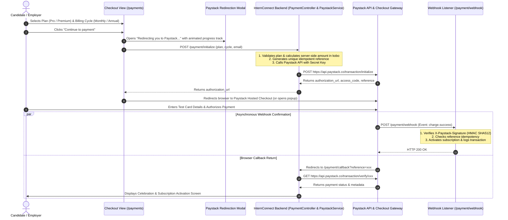

# Paystack Payment Integration Architecture & Implementation Plan

This document outlines the end-to-end architecture and implementation plan for integrating the **Paystack Payment Gateway** into InternConnect. It details the initial **Test Mode** setup, the zero-code configuration switch to **Live Mode**, robust security measures, and an API-ready architecture for web, mobile, and Postman testing.

---

## 1. Flow Overview & User Experience



---

## 2. Paystack Credentials & Environment Setup Guide

### 2.1 Where to find your Credentials on the Paystack Dashboard
To get your API keys for Test Mode:
1. Log in to your **[Paystack Dashboard](https://dashboard.paystack.com/)**.
2. Look at the bottom-left corner of the sidebar and ensure the toggle is set to **Test Mode** (it shows a yellow/orange test badge).
3. Go to **Settings** (gear icon) -> click on the **API Keys & Webhooks** tab.
4. You will see:
   - **Test Secret Key**: Starts with `sk_test_...`
   - **Test Public Key**: Starts with `pk_test_...`
   - **Test Callback URL**: Optional on dashboard (we pass dynamic callback URLs in the initialize request).
   - **Test Webhook URL**: Set to `https://your-domain.com/payment/webhook` (or your ngrok tunnel URL during local testing).

### 2.2 Environment Configuration (`.env`)
All Paystack keys and endpoints will be managed strictly through `.env` variables so you can switch between **Test Mode** and **Live Mode** simply by updating environment variables:

```env
# ==============================================================================
# PAYSTACK PAYMENT GATEWAY CONFIGURATION
# ==============================================================================
# Environment: 'test' or 'live'
PAYSTACK_ENV=test

# API Base URL
PAYSTACK_BASE_URL=https://api.paystack.co

# Paystack API Keys
# Test Keys (for development):
PAYSTACK_PUBLIC_KEY=pk_test_your_test_public_key_here
PAYSTACK_SECRET_KEY=sk_test_your_test_secret_key_here

# Live Keys (for production when ready):
# PAYSTACK_PUBLIC_KEY=pk_live_your_live_public_key_here
# PAYSTACK_SECRET_KEY=sk_live_your_live_secret_key_here

# Merchant Currency
PAYSTACK_CURRENCY=NGN
```

> [!TIP]
> **Switching to Live Mode**: When moving to production, you will simply replace `sk_test_...` with `sk_live_...` and `pk_test_...` with `pk_live_...` in `.env`. No backend code changes will ever be required.

---

## 3. Mandatory Security Standards

To guarantee enterprise-grade security and prevent fraudulent transactions, the implementation enforces the following standards:

1. **Strict Secret Key Isolation**:
   - The Secret Key (`sk_test_...` / `sk_live_...`) is **NEVER** exposed to client-side scripts, JavaScript, or public repositories.
   - All Paystack API communication using the Secret Key is conducted strictly server-side via cURL.

2. **Server-Side Pricing Authority**:
   - Client requests specify only `plan` (`pro` or `premium`) and `cycle` (`monthly` or `annual`).
   - The backend looks up prices from an immutable server-side pricing ledger in kobo (1 NGN = 100 kobo):
     - **Pro Monthly**: ₦2,499 = `249900` kobo
     - **Pro Annual**: ₦24,999 = `2499900` kobo
     - **Premium Monthly**: ₦4,999 = `499900` kobo
     - **Premium Annual**: ₦47,990 = `4799000` kobo
   - Client-submitted currency amounts are discarded and never trusted.

3. **Cryptographic Webhook Signature Verification**:
   - Every incoming webhook at `/payment/webhook` is verified against the `HTTP_X_PAYSTACK_SIGNATURE` header:
     ```php
     $input = file_get_contents('php://input');
     $computedSignature = hash_hmac('sha512', $input, $_ENV['PAYSTACK_SECRET_KEY']);
     if (!hash_equals($computedSignature, $_SERVER['HTTP_X_PAYSTACK_SIGNATURE'] ?? '')) {
         http_response_code(401);
         exit('Invalid signature');
     }
     ```

4. **Idempotency & Transaction Verification**:
   - Every transaction is verified by querying Paystack's official `/transaction/verify/{reference}` endpoint before fulfilling the subscription.
   - References are checked for single-use to prevent duplicate subscription crediting.

5. **SSL/TLS & Secure Cookies**:
   - Enforce HTTPS across all payment routes and callback handlers.

---

## 4. API Readiness (Web, Mobile & Postman)

The backend service layer is structured to support both web browser flows and future REST API calls (e.g. Postman or mobile apps):

- **Service Layer (`App\Services\PaystackService`)**:
  - `initializeTransaction(string $email, int $amountInKobo, string $callbackUrl, array $metadata = []): array`
  - `verifyTransaction(string $reference): array`
  - `verifyWebhookSignature(string $payload, string $signature): bool`

- **Controller Endpoints (`App\Controllers\PaymentController`)**:
  - `GET /payments` or `/checkout`: Renders the interactive 2-column checkout UI.
  - `POST /payment/initialize`: Initializes the transaction. Supports both JSON requests (API/Postman/AJAX) and form submissions.
  - `GET /payment/callback`: Handles customer redirect after payment, verifies reference, and updates user status.
  - `POST /payment/webhook`: Asynchronous webhook endpoint for Paystack notifications.

---

## 5. Proposed Changes

### [Component: Payment Integration]

#### [NEW] [`backend/Services/PaystackService.php`](file:///c:/xampp/htdocs/InternConnect/backend/Services/PaystackService.php)
- Dedicated service class managing Paystack REST API operations (`/transaction/initialize`, `/transaction/verify`, and webhook HMAC signature checks).

#### [NEW] [`backend/Controllers/PaymentController.php`](file:///c:/xampp/htdocs/InternConnect/backend/Controllers/PaymentController.php)
- Handles checkout rendering, transaction initialization, callback verification, and webhook ingestion.

#### [MODIFY] [`backend/routes.php`](file:///c:/xampp/htdocs/InternConnect/backend/routes.php)
- Register payment routes:
  - `GET /payments`, `GET /checkout`, `GET /pricing/upgrade`
  - `POST /payment/initialize`
  - `GET /payment/callback`
  - `POST /payment/webhook`

#### [MODIFY] [`frontend/landing/payment.php`](file:///c:/xampp/htdocs/InternConnect/frontend/landing/payment.php)
- Wire the "Continue to payment" button to trigger the redirection modal, send AJAX request to `/payment/initialize`, and redirect the user smoothly to Paystack's checkout page.

#### [NEW] [`frontend/landing/payment-success.php`](file:///c:/xampp/htdocs/InternConnect/frontend/landing/payment-success.php)
- Confirmation & celebration screen showing transaction summary, active plan, and direct button to candidate dashboard.

#### [MODIFY] [`docs/08-payment-system.md`](file:///c:/xampp/htdocs/InternConnect/docs/08-payment-system.md) & [`docs/24-changelog.md`](file:///c:/xampp/htdocs/InternConnect/docs/24-changelog.md)
- Update documentation to reflect Paystack integration architecture.

---

## 6. Verification Plan

### Automated / Syntax Tests
- Run `php -l` on all newly created backend files.
- Verify cURL execution and JSON payload structures.

### Manual Verification
1. **Initiate Checkout**: Select Pro Monthly (₦2,499) -> Click "Continue to payment" -> Verify modal animation and successful redirect to Paystack Test Checkout.
2. **Test Card Payment**: Enter Paystack Test Card (`5060 6666 6666 6666` or `4084 0840 8408 4084`) -> Complete OTP -> Confirm redirection to `/payment/callback`.
3. **Verification Screen**: Verify the callback calls Paystack Verify API, validates the reference, and renders the success confirmation view with upgraded subscription status.
