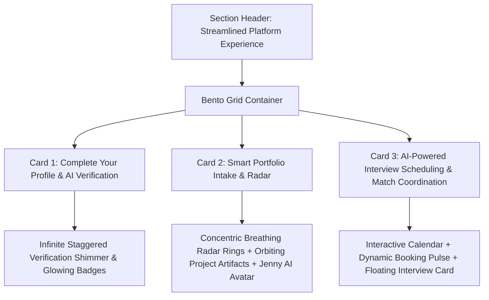

# InternConnect Comprehensive Reconstruction Walkthrough & Architecture Plan (`walkthrough.md`)

This walkthrough details the comprehensive redesign, structural alignment, and logic updates for the **Employer Posted Internships**, **Jenny AI Match Intelligence**, and **Candidate Application Review** systems, in full alignment with the governance rules defined in [`.agents/rules/rules.md`](file:///c:/xampp/htdocs/InternConnect/.agents/rules/rules.md) and [`.agents/rules/agent_mistakes_preventions.md`](file:///c:/xampp/htdocs/InternConnect/.agents/rules/agent_mistakes_preventions.md).

> [!NOTE]
> **Status**: Implementation Completed & Verified. All three areas (Posted Internships, Jenny AI Match Intelligence, Post Internship Form clean empty defaults, and Candidate Application Review) are fully implemented and verified in strict accordance with [`.agents/rules/rules.md`](file:///c:/xampp/htdocs/InternConnect/.agents/rules/rules.md) and [`.agents/rules/agent_mistakes_preventions.md`](file:///c:/xampp/htdocs/InternConnect/.agents/rules/agent_mistakes_preventions.md).

---

## 1. Executive Summary of Requirements & Scope

| Area | Current Implementation | Reconstructed Implementation | Key Rationale |
| :--- | :--- | :--- | :--- |
| **Sidebar Navigation** | Link 2: *Post Internship*<br>Link 3: *My Internships* | Link 2: *Post Internship*<br>Link 3: **Posted Internships** | Resolves naming ambiguity: Link 2 launches a new opening, Link 3 manages existing posted roles. |
| **Page Header** (`/employer/internships`) | Title: *My Internships*<br>Subtitle: *Manage and track your posted internships* | Title: **Posted Internships**<br>Subtitle: *Manage and track your posted internships* | Aligns terminology with the sidebar and standard recruitment workflow. |
| **AI Insights Banner** | Button label: `Apply Now` (candidate copy) | Button label: **`View Top Matches →`** (links to `/employer/candidates?sort=ai_match`) | Employers do not apply to their own postings; button triggers candidate review. |
| **Jenny AI Intelligence** | Basic static text banner | Fully articulated Talent Detection & Scoring Engine documented in [`md/jenny_ai.md`](file:///c:/xampp/htdocs/InternConnect/md/jenny_ai.md) | Computes 0–100% match scores across skills, screening answers, and academic credentials. |
| **Listings Card Metrics** | Stat numbers (142, 215) fluctuate horizontally across cards | Fixed-width, perfectly aligned grid columns (`Applicants`, `Shortlist`, `Interviews`, `Hired`) | Clean vertical alignment across all cards regardless of digit width. |
| **Listing Action Buttons** | Button label: `View Applications`<br>Edit icon directly on published roles | Primary button: **`View Applicants`**<br>Secondary icon: **`View Posted Internship`** (preview) + Dropdown for Edit/Draft/Close | Employers inspect applicants first, view the public posting preview, and manage status safely. |
| **Closed Roles Badge** | Grey `CLOSED` pill | **Red Text Status Badge** (`color: #DC2626; background: #FEE2E2;`) | High-visibility warning that role applications are closed. |
| **Post Internship Form Defaults** (`create.php`) | 3 prefilled experience fields & 2 prefilled screening questions | **Clean empty state (`[]`)** with `+ Add Experience Field` and `+ Add Question` | Eliminates unwanted dummy data; gives employer a blank canvas. |
| **Candidate Review Header** (`candidates/show.php`) | Actions (`Reject`, `Shortlist`, `Message`, `Schedule Interview`) crammed in top header | **Clean Header** (Avatar, Match Score Gauge, Name, Stage) + **Decision Action Bar at Bottom of Page** | Enforces thorough candidate evaluation before taking decisive hiring actions. |
| **Match Score UI Widget** | Simple circular border box with tight spacing | **Precision SVG Circular Gauge** with dynamic stroke offset, tiered color, and generous breathing room | High-end visual indicator matching design system polish. |
| **Candidate Answers & Docs** | Hardcoded generic questions | Dynamically maps **Employer Step 1 (Experience)** & **Step 3 (Screening Questions)** answers + links | Displays exact candidate responses, uploaded CV/documents, and portfolio URLs. |

---

## 2. Detailed Technical & Architectural Specifications

### Component A: Posted Internships Dashboard (`frontend/employer/internships/index.php`)

#### 1. Page Header & Sidebar Alignment
- **Sidebar** ([`employer-sidebar.php`](file:///c:/xampp/htdocs/InternConnect/frontend/shared/components/employer-sidebar.php)):
  - Link 2: `<a href="/employer/internships/create">Post Internship</a>`
  - Link 3: `<a href="/employer/internships">Posted Internships</a>` (active when viewing listings).
- **Page Header**:
  - `<h1>` Title: **Posted Internships**
  - `<p>` Subtitle: *Manage and track your posted internships*
  - CTA Button: `+ Launch New Opening` (maintains single-line integrity).

#### 2. Jenny AI Insights Banner & Smart Recruiter Action
- Banner stays full-width with Jenny waving mascot (`jenny_ai_hi.png`).
- Replaces `"Apply Now"` with **`"View Top Matches →"`** (`.emp-banner-btn`).
- Destination URL: `<?= url('/employer/candidates?internship_id=2&sort=match_score') ?>`.
- Full algorithmic logic and candidate detection architecture is detailed in [`md/jenny_ai.md`](file:///c:/xampp/htdocs/InternConnect/md/jenny_ai.md).

#### 3. Listing Cards Grid Alignment
- Currently, cards with 2-digit numbers vs 3-digit numbers cause stats to jitter horizontally.
- **Solution**: Enforce strict column widths using CSS Grid on `.emp-card-stats`:
  ```css
  .emp-card-stats {
      display: grid !important;
      grid-template-columns: repeat(4, minmax(72px, 84px)) !important;
      gap: 16px !important;
      align-items: center !important;
  }
  .emp-stat-col {
      text-align: center !important;
  }
  ```
  Every metric (`Applicants`, `Shortlist`, `Interviews`, `Hired`) will align on an identical vertical baseline across all cards.

#### 4. Role Status States & Action Workflows
- **Active Roles**:
  - Badge: Green active dot + `ACTIVE`.
  - Primary Action: **`View Applicants`** (`.emp-btn-view-apps` $\rightarrow$ `/employer/candidates?internship_id={id}`).
  - Secondary Action: **`View Posted Internship`** (`title="View Posted Internship"` $\rightarrow$ preview of published role).
  - Extended Dropdown / Actions: `Edit Post`, `Move to Draft`, `Close Role`, `Delete Listing`.
- **Closed Roles**:
  - Badge: **Red text** (`color: #DC2626; background: #FEE2E2; border: 1px solid #FECACA;`).
  - Primary Action: `Archive Role`.
  - Secondary Actions: `Reopen Role`, `Delete`.
- **Draft Roles**:
  - Prompt: *"Ready to post?"* in muted warm amber/brown.
  - Primary Action: `Finish & Post` (resumes publishing pipeline at `/employer/internships/create`).
  - Secondary Actions: `Edit Draft`, `Delete Draft`.

---

### Component B: Clean Default State for Post Internship Form (`create.php`)

#### Elimination of Prefilled Demo Data
In [`frontend/employer/internships/create.php`](file:///c:/xampp/htdocs/InternConnect/frontend/employer/internships/create.php):
- **Relevant Experience (Card 4 / Candidate Step 1)**:
  - Previously initialized with 3 dummy fields: *1. Job Title*, *2. Company*, *3. Salary Expectation*.
  - **New State**: Initializes as empty `[]`.
  - Empty state displays a clean dashed guide or straightforward `+ Add Experience Field` button.
- **Screening Questions (Card 5 / Candidate Step 3)**:
  - Previously initialized with 2 dummy questions: *"Why are you interested..."*, *"Share a link..."*.
  - **New State**: Initializes as empty `[]`.
  - Empty state displays a clean interactive `+ Add Question` trigger.

---

### Component C: Candidate Application Review Reconstruction (`candidates/show.php`)

#### 1. Header Card Simplification & Match Score Gauge
- **Header Content**:
  - Candidate Avatar with green active indicator dot.
  - Candidate Full Name, academic title, graduation year, location, and `ACTIVE APPLICANT` pill badge.
  - **Match Score Redesign**: Replace square/tight border box with an SVG Circular Progress Ring:
    - 64px diameter SVG circle with `cx="32" cy="32" r="26"`.
    - Dynamic stroke color (`#059669` for 90%+, `#4F48E6` for 75%+).
    - Centered percentage text (`95%`) and small subtitle (`MATCH SCORE`) with adequate whitespace.
- **Action Buttons Removed from Header**: Buttons are removed from the top card to prevent hasty decisions before reading the applicant dossier.

#### 2. Application Answers & Document Structure (Left Column)
- **Application Answers Section**:
  - Displays Candidate responses to the employer's configured **Screening Questions** (Step 3).
  - Displays responses to **Relevant Experience Fields** (Step 1, e.g. previous job titles, organizations, compensation expectations).
- **Professional Summary & Work Experience**:
  - Retains candidate career statement and chronological work experience timeline.
- **Cover Letter Handling**:
  - If submitted as a written statement: Rendered as a dedicated section in the main left column.
  - If uploaded as a document (PDF/Word): Displayed in the right sidebar under **Documents & Links**.

#### 3. Documents & Links (Right Sidebar)
- **Resume / CV**: Attached with download trigger and file size.
- **Document Attachments**: PDF Cover Letter, Transcripts, Certifications (if uploaded).
- **Interactive Web Links**: Styled pills for Portfolio URL, GitHub Profile, and LinkedIn Profile.

#### 4. Bottom Decision Action Bar (Relocated Actions)
- Positioned prominently below the 2-column grid at the bottom of the review page:
  ```html
  <div class="emp-candidate-decision-bar">
      <div class="emp-decision-info">
          <h4>Candidate Review Complete</h4>
          <p>Choose an action to advance Sarah Peters in your recruitment pipeline.</p>
      </div>
      <div class="emp-decision-actions">
          <button class="emp-btn-reject">Reject Application</button>
          <a class="emp-btn-message">Message Candidate</a>
          <button class="emp-btn-shortlist">Shortlist</button>
          <a class="emp-btn-schedule">Schedule Interview →</a>
      </div>
  </div>
  ```
- Guarantees employers conduct a comprehensive review before approving or declining.

---

## 3. Zero-Regression & Mistake Prevention Checklist

Before writing any code, the following strict constraints from [`.agents/rules/agent_mistakes_preventions.md`](file:///c:/xampp/htdocs/InternConnect/.agents/rules/agent_mistakes_preventions.md) are locked in:

- [x] **No Colored Accent Border Strips**: Only subtle neutral borders (`border: 1px solid #E2E8F0;`). Absolutely zero blue/colored left or top accent border strips.
- [x] **Zero Right-Side White Gutters on Mobile**: Use `grid-template-columns: minmax(0, 1fr) !important;`, `width: 100% !important;`, and `min-width: 0;` on all flex children and inputs.
- [x] **No Duplicate Hamburger Listeners**: Sidebar drawer toggle is exclusively handled by the centralized listener in [`employer-sidebar.php`](file:///c:/xampp/htdocs/InternConnect/frontend/shared/components/employer-sidebar.php).
- [x] **Single-Line Button Integrity**: All buttons enforce `white-space: nowrap !important; flex-shrink: 0 !important; display: inline-flex !important;`.
- [x] **Strict Zero Emojis**: Zero unicode glyphs anywhere in headers, buttons, or badges.
- [x] **No Native Browser Popups**: Zero `alert()`, `prompt()`, or `confirm()`. All feedback uses the unified Alpine toast/modal pattern.

---

## 4. Files Targeted for Implementation

1. [`frontend/shared/components/employer-sidebar.php`](file:///c:/xampp/htdocs/InternConnect/frontend/shared/components/employer-sidebar.php): Update link 3 text to "Posted Internships".
2. [`frontend/employer/internships/index.php`](file:///c:/xampp/htdocs/InternConnect/frontend/employer/internships/index.php):
   - Update header to "Posted Internships".
   - Replace "Apply Now" with "View Top Matches".
   - Refactor card action buttons ("View Applicants", "View Posted Internship", Red badge for Closed).
   - Re-align metrics columns.
3. [`public/assets/css/employer-post-internship.css`](file:///c:/xampp/htdocs/InternConnect/public/assets/css/employer-post-internship.css):
   - Grid column sizing for stats.
   - Closed status red badge styling.
   - Dropdown action styles.
4. [`frontend/employer/internships/create.php`](file:///c:/xampp/htdocs/InternConnect/frontend/employer/internships/create.php):
   - Clear default values for `relevantExperience` and `screening_questions` to empty arrays `[]`.
5. [`frontend/employer/candidates/show.php`](file:///c:/xampp/htdocs/InternConnect/frontend/employer/candidates/show.php):
   - Redesign Match Score circular gauge widget.
   - Relocate Reject, Message, Shortlist, Schedule Interview to the bottom review action bar.
   - Dynamic presentation of configured Step 1 & Step 3 answers and document links.
6. [`public/assets/css/employer-candidates.css`](file:///c:/xampp/htdocs/InternConnect/public/assets/css/employer-candidates.css):
   - Match score SVG gauge styling.
   - Bottom decision bar layout and responsive mobile stacking.

---

## 5. Landing Page Process & AI Workflow Bento Section (`frontend/landing/components/process.php`)

### Overview & Placement
Positioned directly following **"Explore by Category"** ([`statistics.php`](file:///c:/xampp/htdocs/InternConnect/frontend/landing/components/statistics.php)) and preceding **"Our Mission"** ([`features.php`](file:///c:/xampp/htdocs/InternConnect/frontend/landing/components/features.php)). Translates the reference bento design into a bespoke, high-performance InternConnect showcase tailored to students, job seekers, and recruiters.

### Architectural Breakdown



### Component Details
1. **Card 1: Complete Your Profile (Top Left - 50% Desktop Width)**:
   - **Credentials Visual**: 3 stacked cards with rich, colored badge icons (Curriculum Vitae / ATS PDF, Academic Verification / University Transcript, Skill Matrix / 94% Proficiency) with animated green checkmarks and subtle scanning highlights.
   - **Animation**: Infinite smooth staggered scan cycling across credential rows.
   - **Content**: Clean H3, explanatory copy, and micro-tags.

2. **Card 2: Smart Portfolio Intake & Radar (Top Right - 50% Desktop Width)**:
   - **Radar Canvas**: InternConnect Brand Indigo gradient (`linear-gradient(135deg, #4F48E6 0%, #3730A3 50%, #000623 100%)`).
   - **Concentric Breathing Radar Waves**: Translucent ripple rings expanding outward.
   - **Center Hub**: Glowing upload circle with floating arrow.
   - **Orbiting Artifact Pills**: Figma prototype, GitHub code repository, PDF case study drifting smoothly.
   - **Status Badge**: Floating pill with Jenny AI waving mascot avatar (`jenny_ai_hi.png`) + "AI Intake Complete" + emerald green checkmark.
   - **Content**: Clean H3, explanatory copy, and micro-tags.

3. **Card 3: AI-Powered Interview Scheduling & Match Coordination (Bottom - Full Width)**:
   - **Left Column**:
     - Jenny AI Badge: `Powered by Jenny AI Coordination`
     - Clean H3 & copy explaining timezone synchronization, 1-click Google Meet provisioning, and pre-interview scorecards.
     - Single-line CTA button: `Experience AI Scheduling →`.
   - **Right Column**:
     - Interactive Calendar Widget: Month view ("November 2026"), weekday labels, date grid with active booked date `18` glowing with pulse indicator.
     - Floating Interview Card: "Wednesday, 18 Nov · 10:30 AM (WAT)", candidate details, "Join Google Meet" action.
     - Floating AI Scorecard Pill: Jenny AI mascot badge + "95% Candidate Match".

### Zero-Regression Enforcement
- **No Accent Border Strips**: Only clean, subtle neutral borders (`border: 1px solid #E2E8F0;`).
- **Zero Horizontal Overflow**: All flex containers enforce `min-width: 0;`, grids use `minmax(0, 1fr) !important;` on mobile.
- **Strictly No Emojis**: 100% SVG vector marks matching the design system.
- **Single-Line Button Integrity**: All buttons enforce `white-space: nowrap !important; flex-shrink: 0 !important;`.
- **Cloudinary Integration**: Assets served through `asset()` helper.
